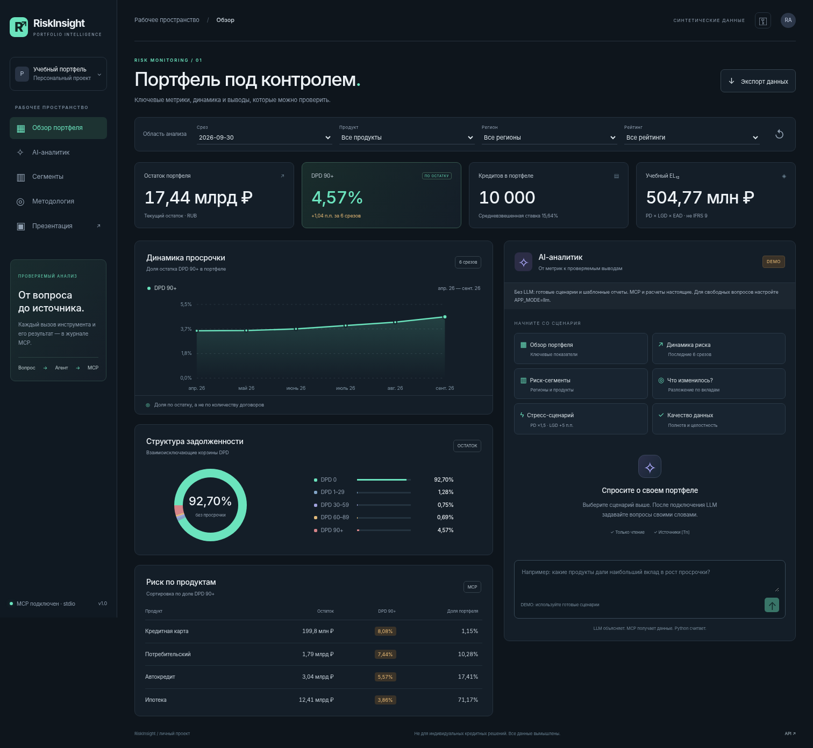

# RiskInsight — AI-аналитик кредитного портфеля

**Вопрос на естественном языке → LLM-агент → MCP → SQLite → аналитический ответ с источниками.**

RiskInsight помогает исследовать качество синтетического кредитного портфеля: просрочку, динамику, риск-сегменты, вклад сегментов в изменение DPD 90+ и условные потери в стресс-сценарии. Это законченный учебный MVP с Web UI, сервером, агентом, тестами и интерактивной презентацией, а не описание будущей разработки.



## 1. Прикладная задача и пользователь

Пользователь — аналитик кредитного риска, которому нужно исследовать качество портфеля, проверить показатели и объяснить изменения. Обычная последовательность «выбрать срез → написать запрос → посчитать метрики → собрать сводку → интерпретировать» объединена в один интерфейс, но расчеты не переданы языковой модели.

**Гипотеза ценности:** сокращение ручных переходов между инструментами и повышение прозрачности анализа. Экономия времени и качество выводов на реальных банковских данных в этом проекте не измерены; такие результаты не заявляются.

Пример запроса для режима LLM:

> Проанализируй качество портфеля за последние шесть доступных срезов. Какие продукты дали вклад в изменение DPD 90+? Отдели факты от гипотез, укажи даты и источники.

Результат содержит ответ, ссылки `[T1]`, `[T2]`, параметры и результаты вызовов MCP, время выполнения и экспорт в Markdown/JSON. Структура отчета и формулировки в режиме LLM определяются моделью, а не набором шаблонов.

## 2. Что реализовано

| Компонент | Реализация |
|---|---|
| Web UI | Адаптивный HTML/CSS/JavaScript: фильтры, KPI, график, корзины DPD, таблица продуктов, чат |
| API | FastAPI, валидация Pydantic, health/readiness, ошибки и токен доступа |
| AI | Ограниченный по шагам tool-calling loop, OpenAI-compatible Chat Completions |
| MCP | Отдельный процесс, JSON-RPC через stdio, handshake, 9 tools, ресурс методологии |
| Расчеты | Python + параметризованный SQL, read-only SQLite, деньги в целых копейках |
| Данные | 10 000 вымышленных кредитов × 12 месячных срезов = 120 000 наблюдений |
| Проверяемость | Источники `[Tn]`, фактические аргументы, результаты и события JSON-RPC |
| Экспорт | Снимок дашборда JSON, отчет Markdown с источниками, полный журнал JSON |
| Инфраструктура | Dockerfile, Compose, Render Blueprint, GitHub Actions |
| Материалы | SPEC.md, AGENTS.md, README, архитектура, тест-отчет, сценарий защиты, HTML-презентация |

Данные синтетические. Срезы фиксированы: **31.10.2025–30.09.2026**. Это не текущие банковские показатели и не информация о реальных клиентах.

## 3. Быстрый запуск

Требуется **Python 3.11+**. Node.js, фронтенд-сборщик, ключ LLM и пакет `mcp` для базового запуска не нужны. Нужен интернет для первоначальной установки Python-зависимостей.

### macOS / Linux

```bash
cd riskinsight
python3 -m venv .venv
source .venv/bin/activate
pip install -r requirements.txt
cp .env.example .env
python -m uvicorn app.main:app --host 127.0.0.1 --port 8000 --workers 1
```

### Windows PowerShell

```powershell
cd riskinsight
py -3 -m venv .venv
.\.venv\Scripts\python.exe -m pip install -r requirements.txt
Copy-Item .env.example .env
.\.venv\Scripts\python.exe -m uvicorn app.main:app --host 127.0.0.1 --port 8000 --workers 1
```

Откройте `http://localhost:8000`. Синтетическая БД создается при первом старте. Приложение не скачивает рыночные или банковские данные. В default-конфигурации включен честно обозначенный **DEMO**: выбирайте готовые сценарии. Свободное текстовое поле в DEMO отключено.

Дополнительные адреса:

- `http://localhost:8000/presentation` — интерактивная HTML-презентация;
- `http://localhost:8000/api/docs` — схема API;
- `http://localhost:8000/api/health` — liveness и конфигурационный статус;
- `http://localhost:8000/api/ready` — реальный MCP handshake и ping; требует токен, если настроен.

### Docker

```bash
cp .env.example .env
# Windows: Copy-Item .env.example .env

docker compose up --build
```

Откройте тот же порт 8000. Контейнер запускается не от root. Данные воспроизводимо создаются заново, отдельный том для учебного набора не обязателен. Docker-сборка в среде подготовки не выполнялась, потому что Docker CLI/daemon здесь отсутствует; перед публикацией проверьте сборку на своей машине.

## 4. Подключение настоящей LLM

В `.env` укажите параметры своего **Chat Completions endpoint с поддержкой function/tool calling**:

```dotenv
APP_MODE=llm
LLM_BASE_URL=https://api.openai.com/v1
LLM_API_KEY=YOUR_PRIVATE_API_KEY
LLM_MODEL=YOUR_AVAILABLE_TOOL_CALLING_MODEL
APP_ACCESS_TOKEN=YOUR_LONG_RANDOM_APP_TOKEN
```

Имя модели намеренно не зафиксировано: доступность зависит от провайдера, региона и аккаунта. Нужны `messages`, `tools`, `tool_choice` и `max_completion_tokens`; возможность поддержки этих полей проверяйте у выбранного провайдера. Совместимость с любым сервисом, который называет себя OpenAI-compatible, не гарантируется.

Для локальной модели задайте ее совместимый URL, например `http://localhost:11434/v1`, имя установленной tool-capable модели и непустой ключ-заглушку, если сервер ключ не требует. Локальный сервер тоже должен поддерживать используемый формат API. Из Docker `localhost` означает сам контейнер; для сервера на хосте используйте `host.docker.internal` с соответствующей настройкой Docker на вашей ОС. Локальная LLM и эти варианты сети здесь не проверены.

Перезапустите приложение. В диалоге доступа браузера вводите **APP_ACCESS_TOKEN, а не LLM_API_KEY**. Ключ модели остается на сервере. Токен приложения хранится только в памяти вкладки и не включается в экспорт.

Проверьте действительный вызов модели:

```bash
python -m scripts.check_llm
python -m scripts.smoke
```

`check_llm` использует ваш платный или локальный провайдер; внешние запросы могут тарифицироваться. Проверьте бюджет в аккаунте провайдера. При ошибке ключа, API или тайм-ауте приложение показывает ошибку и **не переключается молча на DEMO**.

## 5. Архитектура

```text
Браузер: HTML / CSS / JS
          │ HTTP, вопрос + фильтры
          ▼
FastAPI / api/chat ─────────► LLM Chat Completions
          │                  выбор инструментов / объяснение
          │                 ◄──── tool_calls
          ▼
MCP client: initialize → tools/list → tools/call
          │ JSON-RPC / stdio, отдельный процесс
          ▼
MCP server: Pydantic contracts → Analytics
          │ фиксированный параметризованный SQL
          ▼
SQLite: синтетические loans + monthly snapshots
          │ агрегированные результаты
          ▼
source_ref [Tn] → LLM → ответ + журнал в браузере
```

Даже дашборд получает портфельные метрики через MCP. HTTP-сервер не читает их напрямую из SQLite. Единственный write-path — создание демонстрационного набора при старте или через CLI.

**Почему не Streamlit:** отдельный FastAPI backend и статический UI позволяют явно разделить API, авторизацию, агентный цикл и интерфейс, без дополнительного фронтенд-сборщика.

**Почему SQLite:** для неизменяемого набора в 120 000 строк достаточно одной локальной базы; меньше инфраструктурных зависимостей. Реальные многопользовательские данные потребуют другой модели доступа и, возможно, PostgreSQL.

**Почему MCP без обязательного SDK:** реализован небольшой поддерживаемый поднабор официального wire protocol `2025-06-18` — tools/resources через stdio. Это позволяет тестировать настоящие межпроцессные сообщения без зависимости от версии SDK. Это **не полная реализация всех MCP-возможностей**: нет remote Streamable HTTP, sampling, elicitation или subscriptions. Независимая проверка официальным Python SDK предусмотрена отдельно, но здесь не запускалась из-за отсутствия пакета и сетевого доступа для установки.

## 6. MCP-инструменты

| Инструмент | Назначение |
|---|---|
| `get_dataset_context` | Даты, допустимые категории и определения метрик |
| `get_portfolio_summary` | Остаток, количество, DPD, ставка, учебный EL |
| `get_delinquency_distribution` | Непересекающиеся DPD-корзины |
| `get_npl_trend` | Исторические срезы и изменение доли в п.п. |
| `analyze_segment` | Продукты, регионы или рейтинги |
| `get_top_risk_segments` | Топ по DPD90+, отсечение малых сегментов |
| `explain_npl_change` | Разложение изменения доли на риск и структуру |
| `run_stress_scenario` | What-if по PD/LGD, не прогноз |
| `check_data_quality` | Целостность, диапазоны и полнота набора |

Схемы и исполнение описаны одним реестром `app/tool_registry.py`. Полный экспорт JSON Schema: [`docs/mcp-tools.json`](docs/mcp-tools.json). Общие фильтры — `product`, `region`, `risk_band`; для среза `as_of`; для динамики `start_date`, `end_date`. Неизвестная дата или категория дает ошибку, а не тихую подмену выборки.

MCP-ресурс: `riskinsight://methodology`. В журнале видны реальные `initialize`, `notifications/initialized`, `tools/list`, `tools/call`. Это журнал вызовов, не скрытые рассуждения LLM.

### Независимый клиент SDK / Inspector

```bash
pip install -r requirements-sdk.txt
python -m scripts.sdk_smoke
```

Или подключите MCP Inspector к stdio-команде:

```bash
python -m app.mcp_server --database /absolute/path/to/riskinsight/data/portfolio.sqlite
```

Перед отдельным запуском создайте БД командой `python -m scripts.seed`. `stdout` сервера предназначен только для JSON-RPC; не запускайте его как обычную интерактивную CLI-аналитику. SDK/Inspector-проверка — отдельный обязательный пункт приемки перед заявлением о совместимости с внешними MCP-хостами.

## 7. Метрики и ограничения

В проекте **NPL90 proxy** определен как отношение остатка по договорам с `DPD >= 90` к общему остатку на том же срезе. Это учебное определение; оно не покрывает все регуляторные критерии проблемности.

`DPD30+`, `DPD60+`, `DPD90+` — вложенные множества. Корзины `0`, `1–29`, `30–59`, `60–89`, `90+` не пересекаются. В API доля `0.05` означает `5%`. Разница `5% − 4%` равна `+1 п.п.`, а не `+1%`.

Учебный `EL12 = Σ(balance × pd_12m × lgd)`. EAD упрощенно равен остатку, для `DPD >= 90` генератор задает `PD=1`. Это **не IFRS 9 ECL**, не оценка бухгалтерского резерва, не валидированная модель потерь. Стресс-сценарий изменяет PD/LGD, ограничивает их единицей и фиксирует EAD.

Разложение изменения: `Δ(w × r) = mean(w) × Δr + mean(r) × Δw`. Здесь `w` — доля сегмента в остатке, `r` — доля DPD90+ внутри сегмента. Результаты округляются на выходе; сумма округленных компонент может отличаться в последних знаках. Это математическая атрибуция, не причинный вывод.

У пустой выборки доли равны `null`, а не нулю. Данные — фиксированная когорта без новых выдач и списаний. PD/LGD не откалиброваны. Региональные названия и категории не выражают реальную оценку кредитоспособности.

Ссылки LLM проверяются на существование успешного MCP-вызова, но автоматическая проверка каждого числа и логической правильности интерпретации **не реализована**. Ответ проверяет человек. История сообщений видна в браузере, но каждый запрос аналитически независим; ссылаться на прошлый ответ фразой «а теперь по ним» без уточнения области не следует.

## 8. Тесты и воспроизводимость

```bash
pip install -r requirements-dev.txt
python -m pytest -q
python -m scripts.smoke
```

Покрыты ручной расчет метрик на маленькой базе, сверка корзин, фильтры, пустые выборки, неизвестные даты, единицы измерения, стресс-ограничения, декомпозиция, read-only режим, SQL allowlist, настоящий MCP-процесс, ошибки JSON-RPC, агентный цикл, восстановление после неверного JSON от модели, защита ключа, API-токен, лимит запросов и отсутствие тихого fallback.

Браузерная проверка (при уже запущенном локальном сервере без токена доступа):

```bash
pip install -r requirements-ui.txt
python -m playwright install chromium
python -m scripts.ui_smoke
```

Проверяются фильтры, раскрытие источников, три экспорта, мобильная компоновка и интерактивность слайдов. В среде подготовки политика Chromium запрещала прямую сетевую навигацию: использован явно обозначенный `--bridge`, который передает запросы настоящему HTTP-серверу через `httpx`. Это **не** проверка публичного HTTPS, браузерной CSP или внешнего хостинга. В обычной среде запускайте без `--bridge`.

GitHub Actions запускает тесты для Python 3.11 / 3.12 / 3.13 после публикации репозитория. В среде подготовки фактически проверен **Python 3.13.5**. Успешный запуск CI на GitHub заранее не заявляется.

Подробности: [`docs/TEST_REPORT.md`](docs/TEST_REPORT.md). Снимок версий: `requirements-tested.txt`. Версии в `requirements.txt` заданы ограниченными диапазонами; это не полностью зафиксированный lockfile. При обновлениях повторите тесты.

## Eval — оценка качества AI-аналитика

### Цель оценки

Проверить способность локальной модели Qwen3 8B корректно понимать вопросы кредитного аналитика, выбирать MCP-инструменты, использовать результаты расчётов и формировать достоверные ответы.

### Методика

Для оценки подготовлен набор из 10 тестовых вопросов. Каждый тест проверяется по четырём критериям:

1. Корректность выбора MCP-инструментов.
2. Точность числовых показателей относительно SQLite.
3. Полнота ответа на вопрос.
4. Отсутствие вымышленных данных и необоснованных выводов.

### Анализ ошибок

Для каждой обнаруженной ошибки фиксируются:

- Тестовый вопрос.
- Ожидаемый результат.
- Фактический ответ модели.
- Вызванные MCP-инструменты.
- Причина ошибки или предполагаемая причина.
- Предпринятое исправление.
- Результат повторной проверки.

### Ограничения оценки

Оценка выполняется на синтетическом портфеле. Полученные результаты не подтверждают пригодность модели для промышленного кредитного риск-менеджмента. Точность и стабильность могут зависеть от версии Qwen, параметров генерации и сложности запроса.

## Публикация GitHub и Render

### GitHub

Создайте **публичный пустой репозиторий** `riskinsight` в своем аккаунте. Убедитесь, что `.env`, ключи и данные реальных клиентов не добавляются в Git.

```bash
git init
git add .
git status
# Проверьте: .env отсутствует в списке; README и docs присутствуют.
git commit -m "Implement RiskInsight MVP with MCP analytics"
git branch -M main
git remote add origin https://github.com/YOUR_ACCOUNT/riskinsight.git
git push -u origin main
```

Не вводите `YOUR_ACCOUNT` буквально; используйте адрес созданного репозитория. При публикации исходников используйте свой аккаунт и предусмотренную GitHub аутентификацию.

### Render

Подключите GitHub-репозиторий в Render и создайте сервис из `render.yaml` (Blueprint) либо Docker Web Service с этим Dockerfile. Тариф и возможную оплату подтвердите в своем аккаунте. Проект не предполагает определенный бесплатный тариф.

Blueprint генерирует `APP_ACCESS_TOKEN`. Скопируйте его из настроек сервиса и используйте в диалоге доступа. На первом этапе оставьте `APP_MODE=demo`, проверьте health, dashboard и сценарий. Затем в **секретных серверных переменных** задайте `LLM_API_KEY`, `LLM_MODEL`, переключите `APP_MODE=llm`, перезапустите и выполните smoke-тест.

```bash
python -m scripts.smoke --base-url https://YOUR_SERVICE.onrender.com
```

`APP_ACCESS_TOKEN` в локальном окружении smoke-теста должен совпадать с токеном хостинга. Docker CMD слушает `0.0.0.0` и порт из `$PORT`. MCP остается приватным subprocess внутри контейнера; открывать отдельный публичный MCP-порт не требуется.

База синтетическая и воспроизводимая, поэтому эфемерный диск допустим для MVP. Для реальной базы — внешнее хранилище, резервное копирование, ролевой доступ и политика работы с данными.


## 12. Первоисточники технических решений

Официальные материалы, использованные при реализации:

- MCP lifecycle: https://modelcontextprotocol.io/specification/2025-06-18/basic/lifecycle
- MCP stdio transport: https://modelcontextprotocol.io/specification/2025-06-18/basic/transports
- MCP tools: https://modelcontextprotocol.io/specification/2025-06-18/server/tools
- OpenAI function calling: https://developers.openai.com/api/docs/guides/function-calling
- MCP Python SDK v1: https://py.sdk.modelcontextprotocol.io/v1/
- Render Web Services: https://render.com/docs/web-services
- Render Docker: https://render.com/docs/docker
- Render secrets: https://render.com/docs/configure-environment-variables
